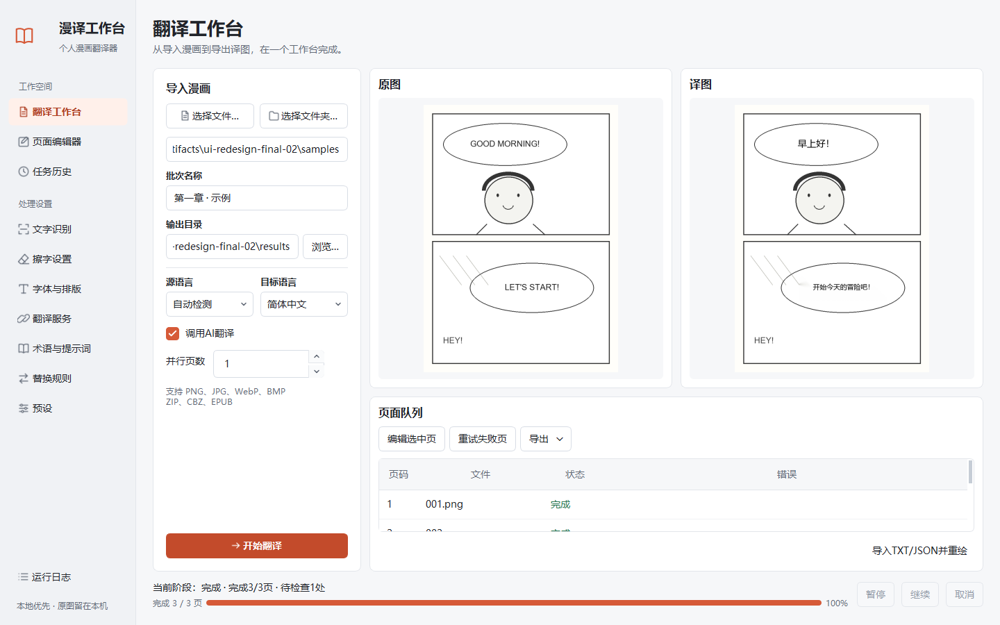

# 个人漫画翻译器

一个面向 Windows 的中文漫画翻译桌面项目。使用本地 OCR 识别文字，可连接 OpenAI 兼容文本翻译服务，也可离线识别后人工填写译文。

**当前版本：0.1.0-alpha.1，早期源码测试版。** 支持 Windows 10/11 x64、Python 3.12；尚未提供独立安装包。复杂漫画的识别、擦字和排版效果仍需人工检查。

[下载测试版](https://github.com/VioletandSakura/manhwa-translator/releases) · [快速开始](docs/QUICK_START.md) · [发布记录](CHANGELOG.md) · [报告问题](https://github.com/VioletandSakura/manhwa-translator/issues)

新版采用侧栏工作台：左侧导入与处理设置，右侧对照原图、译图和队列。页面编辑器提供多行校对、分组排版面板和固定保存区，支持小窗口与高 DPI。下面是软件实际运行截图，画面中的漫画为自制验收样例。



布局、全部页面与验证范围见 [界面重设计记录](docs/UI_REDESIGN_2026-10-28.md)。

## 先跑通一个完整流程

### 1. 安装与启动

准备 **Windows x64 版 Python 3.12**。首版的安装约束和自动检查仅覆盖此组合；Python 3.11、3.13+、Windows ARM 与其他系统不在首版支持范围内。

下载或克隆项目，解压到当前账号可以写入的文件夹。在项目文件夹打开 PowerShell，执行：

```powershell
powershell -ExecutionPolicy Bypass -File .\scripts\setup.ps1
```

安装会按 `constraints-windows-py312.txt` 联网下载经过验证的依赖版本，并检查依赖及图形启动器；约束文件不是带哈希的离线依赖包。完成后双击 **`启动个人漫画翻译器.vbs`**，只显示软件窗口；原来的 `.bat` 入口也会转交给它。需要命令行排错时运行：

```powershell
.\.venv\Scripts\python.exe run.py
```

程序路径跟随项目所在位置，不要求存在特定盘符。移动源码项目后，请重建虚拟环境；Python 虚拟环境本身不保证可移动。

部分旧 uv 环境的 `pythonw.exe` 实际仍是控制台程序。启动器会检查并使用 Python 自带的图形启动程序，让软件独立于命令行窗口运行。启动错误记录在 `logs/startup.log`。

### 2. 不填密钥，先体验离线识别

1. 在“翻译工作台”选择 `docs/samples/horizontal.png` 体验自制日文样例，也可以选择自己的图片、文件夹、ZIP、CBZ、EPUB。
2. 多页或压缩包任务填写“批次名称”，如 `demo-01`。
3. **取消勾选“调用AI翻译”**，确认输出目录后开始处理。
4. 完成后检查识别结果；离线识别不会擦掉原文，也不会调用翻译服务。

RapidOCR 的默认小模型在本机已安装时直接使用；首次使用、模型缺失时，其依赖库可能联网下载模型。MangaOCR 和 LaMa 等可选模型需要另外准备。

### 3. 人工修改并导出

1. 在队列表格选择一个已处理页面，点击“编辑选中页”。
2. 点击画面中的文字框，修改右侧译文，点击“保存并重绘译图”。右侧面板可滚动。
3. 回到“翻译工作台”检查结果，在“导出”菜单中选择“导出TXT”“导出JSON”或“导出译图ZIP”。

红色框需要人工检查：点击“确认处理”后才会擦字和绘制译文；“保留原文”会保留或恢复最初原文。修改译文不会自动接受待检查区域。编辑器顶部可切换原图/译图作前后对照。

点击“下一处待检查”或按 F8，可以跳到需要确认或排版溢出的区域；当前页全部处理后，会继续寻找当前任务的其他页。跨页前会保存当前编辑。蒙版画笔与橡皮擦按一整笔撤销/重做，直接拖动文字框也可以撤销。

“字体与排版”中的字体文件和字号范围会用于新任务、重绘，也可保存并放入预设。文本框字号为“自动”时使用全局范围；指定字号会覆盖全局范围，并在放不下时缩小。颜色、对齐、描边、旋转及基础竖排都会作用于译图。

连续修改文字和样式时会复用校验过的擦字底图；原图、蒙版或人工处理范围变化后会重新处理。人工译文导入只重绘实际改变的页面，内容不变时直接跳过。导入、导出和打包在后台进行，进度只刷新变化行。

蒙版画笔可补充擦字区域，橡皮擦撤回补充蒙版，已保存蒙版会随页面再次打开。未确认和保留原文的区域会受到保护。移动、放大译文框不会扩大原文擦除范围；重绘优先使用输出中的原图副本或 `originals.zip`，避免把之前的擦字痕迹反复叠加。老结果如果已经缺少原图，界面会提示恢复原文的限制。

“页面编辑器”也能通过“打开页面JSON”打开输出目录 `metadata` 中的单页文件。聚合导出的翻译 JSON 应使用“导入TXT/JSON并重绘”。

人工交换文件只更新译文。JSON 按页面标识和文本框 ID 匹配，允许调整页面顺序；请保留导出文件的原文、ID 和页面信息。全部页面校验通过后才会保存，写盘失败会回滚；若进程在导入中途结束，下次打开时会恢复整批旧译文。位置、样式和人工检查状态请在编辑器内修改。

### 4. 配置在线翻译

进入“翻译服务”，填写服务名称、服务商提供的 Base URL、模型和 API Key。点击“安全保存”，获取模型列表并选择账号可用的模型，再“测试连通性”。模型是否可用以服务商实际返回为准。

启用且测试通过的通道才会参与翻译。程序把 OCR 得到的文字发送给所选服务，不向纯文本翻译接口发送原图。实际翻译可能产生服务商费用。API Key 保存在当前账号的 Windows 凭据管理器，服务标识为 `MangaTranslatorPersonal`。

### 5. 暂停、退出与恢复

- **暂停**：等待当前步骤结束，在检测、识别、翻译、擦字或渲染之间暂停；点击“继续”接着处理。
- **取消**：当前步骤结束后停止，不再启动后续步骤或自动重试，已完成页面保留。之后可从“任务历史”恢复未完成页。
- **关闭窗口**：系统托盘可用时隐藏到托盘并继续处理；从托盘菜单选择“退出”才会安全结束。退出时窗口会显示等待提示，后台工作结束后自动关闭。
- **恢复历史任务**：跳过已完成页。新任务会记住识别引擎、翻译开关、语言、检查阈值、字体和并行数；API 通道、提示词、术语表与替换仍使用当前配置。早期任务没有保存这些设置，会按当前面板运行，日志中有提示。
- **重试失败页**：只重试队列表格中选中的失败/取消页；需等待当前任务结束。

总体百分比按成功完成页数计算，不随并行页序回退；失败页数单独显示。退出、取消和暂停不会强行打断正在执行的 OCR 或已发出的网络请求，因此可能需要等当前步骤或网络超时结束。强制结束进程后，启动会把遗留“处理中”的页转为待恢复，不会自动开始翻译。

## 文件放在哪里

以下位置均相对于项目目录：

| 位置 | 用途 |
| --- | --- |
| `outputs/批次名称/` | 默认任务输出 |
| `data/app.db` | 本地任务、检查点、设置和翻译缓存 |
| `data/imports/` | ZIP、CBZ、EPUB 提取的图片 |
| `logs/app.log` | 脱敏运行日志 |
| `.cache/` | 临时文件、依赖缓存和可选模型缓存 |
| `models/` | 手动准备的可选模型 |

输出包含 `inpainted`、`translated`、`metadata` 等目录；未填写译文的离线结果在 `translated` 中保留原图内容。全部页面完成后，程序会把输出中的原图副本压缩为 `originals.zip`，完整检查文件清单、CRC 和副本内容后才移除散文件。归档异常会保留副本并写入日志，导入源文件不会被删除。

同名且非空的批次目录不会被覆盖。不同文件夹里同名页面、同名压缩包和大小写冲突会在新导入时分别保留；有歧义的页面会多保存一份临时输入副本。此修复无法恢复旧版本已经覆盖的文件。开始任务前会实际检查输出目录的写入权限。旧任务仍记住原来的输出路径；改动项目位置不会自动迁移旧结果。

## 已有能力与当前限制

已接入主要流程的能力包括：图片、文件夹、ZIP/CBZ、EPUB 页序导入；本地检测与识别；OpenAI 兼容翻译通道与缓存；OpenCV 擦字与 Pillow 排版；任务暂停、恢复、取消和重试；人工文本交换；单页文字修改与重绘。

当前行为与仍需打磨的边界如下：

- 术语表和提示词已接入实际请求；替换规则按顺序对返回译文作字面替换，不是正则表达式。每行使用Tab分隔两列，空行与以 `#` 开头的注释会忽略；替换目标留空表示删除。改变这些设置会使用独立缓存。
- 基础竖排已支持多列从右至左排布，精细日文竖排标点、异体字和排版质量仍需继续验证。
- 支持设置 1–4 个并行页面，OCR 推理仍串行。已验证步骤间暂停、安全退出和强制结束后的恢复；尚未做长时间大批量压力测试。
- 翻译结果数量不一致时，仅对出错块拆小尝试一次修复，仍失败就停止该页，不猜测错位译文。已成功的块会及时写入缓存，重试时复用。
- CBZ 采用 ZIP 容器处理；CBR、7z、PDF 输入和 PSD 分层导出尚未支持。
- 自制日文样本中，横排短句可正常识别，竖排仍会拆字、漏字、误识别绘画线条；“高精度”设置不保证解决这些问题。大批量复杂日漫的整体质量尚未验证。请先检查少量页面，保留原文和原始文件。
- 源码包会在独立虚拟环境及 Windows CI 中验收；这不能覆盖每台电脑、网络或所有 Windows 账号权限。具体已通过项目和未验证边界见 [首版验收](docs/RELEASE_2026-10-31.md)。

详细问题与下一轮验收目标见 [打磨计划](docs/OPEN_SOURCE_ROADMAP.md)。

性能优化的实测结果与限制见 [性能与编辑效率记录](docs/PERFORMANCE_2026-10-28.md)：重复编辑和输出阶段有改善，当前没有整体 OCR 提速或全应用内存下降的结论。

## 可选模型

| 功能 | 本地位置 | 依赖 |
| --- | --- | --- |
| MangaOCR 日漫识别 | `models/manga-ocr-base/` | `requirements-mangaocr.txt`，含较大的 PyTorch 等依赖 |
| LaMa ONNX 擦字 | `models/lama.onnx` | ONNX Runtime；缺失或失败时回退到 OpenCV |

普通使用不要求安装这些可选项。模型体积、许可和来源需要在准备模型时另外核对；项目不附带这些可选权重。

## 开发与验证

安装开发依赖：

```powershell
powershell -ExecutionPolicy Bypass -File .\scripts\setup.ps1 -Dev
```

运行自动化测试：

```powershell
$env:QT_QPA_PLATFORM='offscreen'
.\.venv\Scripts\python.exe -B -m pytest -q
```

真实桌面组件与本地 OCR 流程检查（在可见桌面运行，另开一个 PowerShell，或先移除上面的 `QT_QPA_PLATFORM` 环境变量）：

```powershell
.\.venv\Scripts\python.exe -B scripts\qa_desktop.py --output-dir .artifacts\desktop-qa-01
```

检查脚本默认使用自制示例图和独立数据库，不读取你的密钥、不调用真实翻译 API。它实际执行界面按钮、OCR、人工修改、重绘和导出；原生文件选择窗口由测试替代。结果包括截图、图片、导出文件和 `report.json`。每次请使用新的输出子目录，避免覆盖上次证据。

需要验证真实付费服务时，在软件中保存 DeepSeek 密钥后显式使用 `--live`：

```powershell
.\.venv\Scripts\python.exe -B scripts\qa_desktop.py --live --output-dir .artifacts\live-qa-01
```

该模式会发送三句自制日文对话和两张英文样本识别出的文字，产生真实服务费用。它读取账号实际可用的模型名单，记录请求数量和 token 用量，并验证缓存命中不再发起请求。密钥不会写入报告；也可用 `--key-file` 指定含有 `DEEPSEEK_API_KEY` 的本地环境文件。普通 DeepSeek 文本翻译明确使用非思考模式，其他兼容服务不附加 DeepSeek 专属参数。

当前版本的验证范围和仍未验证的内容见 [首版验收](docs/RELEASE_2026-10-31.md)，此前的验收保留在 [历史记录](docs/QA_2026-10-27.md)。本项目源码采用 [MIT 许可](LICENSE)，依赖、字体和可选模型保留各自条款，详见 [第三方声明](THIRD_PARTY_NOTICES.md)。源码 ZIP 不附带依赖、模型或系统字体；包含这些内容的独立安装包尚未发行。

第二轮设置验收可运行 `scripts/qa_round2.py --output-dir .artifacts/round2-qa-01`；显式增加 `--live` 会用已保存的 DeepSeek 密钥做两个小型真实请求，验证术语、提示词、替换与缓存。图像和界面验收结果写入指定目录，详见 [第二轮记录](docs/QA_ROUND2_2026-10-28.md)。

第三轮恢复验收可运行 `scripts/qa_round3.py --output-dir .artifacts/round3-qa-01`。它只在独立测试目录中运行并强制结束自己创建的子进程，使用真实本地 OCR 与离线翻译夹具，验证三种处理阶段的恢复、缓存复用，以及 JSON 导入中断后的回滚；不读取账号密钥、不调用付费服务。详见 [第三轮记录](docs/QA_ROUND3_2026-10-28.md)。
