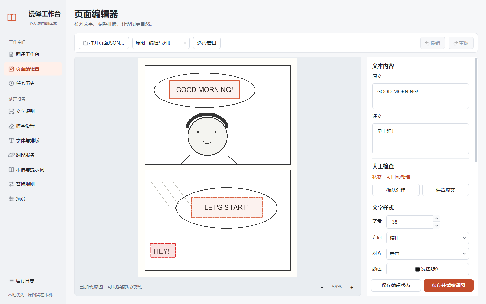
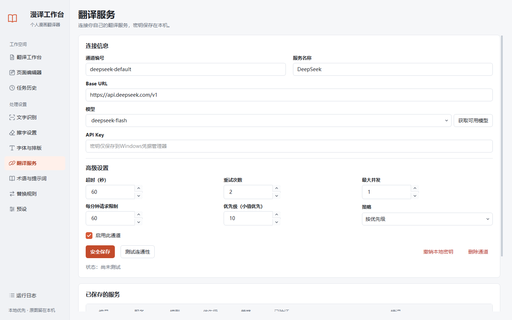

# 界面重设计与验收

日期：2026-10-28。此次调整覆盖原生 PySide6 桌面软件的全部11个页面。

## 设计方向

采用编辑工作台的布局：纸灰背景、白色内容区、深色正文、朱橙色重点操作。参考 [Linear 对层级、平衡和密度的调整](https://linear.app/changelog/2024-03-20-new-linear-ui)与 [Windows 内容布局和间距指南](https://learn.microsoft.com/en-us/windows/apps/design/style/spacing)，按漫画处理流程组织界面。

正文使用系统 Microsoft YaHei UI / Microsoft YaHei，默认14px；主标题26px、分组标题16px、辅助说明12px。主文字为 `#202329`，辅助文字为 `#626a77`，背景为 `#f6f7f9`。主按钮采用更深的 `#c34b2b`，白字对比度约4.81:1；其他强调保留 `#d65a38`。空白、边框、图标和按钮状态使用统一规范。

界面使用代码和项目内的原创线条图标，不需要联网加载字体或素材。三个本地图标资源通过项目的 package-data 配置声明；已验证源码运行，尚未在本轮构建独立安装包。

## 布局与操作

- 侧栏分为工作空间与处理设置，包含翻译工作台、页面编辑器、任务历史及全部设置入口；当前页面有明确选中态。
- 工作台左侧负责导入、语言、批次和输出设置，右侧对照原图与译图，下方查看页面队列。可以拖动预览与队列间的分隔线调整空间。
- 导出 TXT、JSON、译图 ZIP 集中到“导出”菜单；编辑、失败重试和人工译文导入仍有直接入口。
- 开始按钮和底部状态控制保持可见，长阶段文字不会挤走暂停、继续与取消。
- 设置页有明确分组并可以滚动；短数字控件有合适宽度。下拉箭头、上下调整箭头和复选框勾号随项目提供。
- 编辑器原文和译文支持多行输入，右侧按文本内容、人工检查、文字样式、位置与角度、蒙版设置分组；保存和重绘固定在底部。
- 编辑器支持适应窗口、缩放、撤销和重做；浅色文字颜色使用色块展示，不再使颜色按钮的文字难以辨认。
- 任务与服务表格按整行选择且不能直接改写；长路径在历史中显示名称，完整路径保留在提示文字中，时间按本地时间显示。
- 原有翻译、缓存、原图保护、中断恢复和编辑保存逻辑保留；保存预设后会自动选中新保存的预设。

快捷键：`Ctrl+O` 选择漫画输入，`Alt+1` 翻译工作台，`Alt+2` 页面编辑器，`Alt+3` 任务历史。编辑器的撤销与重做继续使用 `Ctrl+Z` / `Ctrl+Shift+Z`。

## 实际界面

以下为软件实际运行的截图。图中的漫画由验收脚本自产，示例任务与译文用于检查布局，不属于用户正式任务。






## 验证

- **237项自动化检查通过**，包含侧栏导航同步、小窗口边界、输入面板内裁切、键盘操作、表格行为、预览缩放、预设保存与还原，以及此前翻译与恢复流程的回归检查。
- 100%与125%缩放各生成19张真实 Qt 截图，覆盖全部11页、1440×900、1366×768、1024×700，以及长退出状态、设置页底部和编辑器底部。
- 真实 Qt 离线操作完成了本地 OCR、人工修改、重绘、通过实际菜单导出 TXT/JSON/ZIP。
- 第二轮设置回归通过：字体、预设、颜色/对齐/旋转/描边、竖排、蒙版、人工确认和保留原文。
- 所有界面验收使用独立数据库、空密钥后端和自产样本；没有读取系统 API Key 或发起付费翻译。
- 正式数据核对仍为9个任务、674页、545个完成页，没有重跑正式漫画任务。

桌面控制桥接工具未能初始化，本轮采用项目自己的 Qt Test 事件和 `QWidget.grab()` 进行真实组件操作与截图。文件选择与颜色选择对话框在流程脚本中由测试替代；没有声称逐个手动操作过 Windows 原生对话框。

复现界面截图：

```powershell
.\.venv\Scripts\python.exe scripts\qa_ui_redesign.py --output-dir .artifacts\ui-review-01
.\.venv\Scripts\python.exe scripts\qa_ui_redesign.py --scale-factor 1.25 --output-dir .artifacts\ui-review-125-01
```

复现流程：

```powershell
.\.venv\Scripts\python.exe -m pytest -q
.\.venv\Scripts\python.exe scripts\qa_desktop.py --output-dir .artifacts\desktop-review-01
.\.venv\Scripts\python.exe scripts\qa_round2.py --output-dir .artifacts\settings-review-01
```

最终截图证据位于 `.artifacts/ui-redesign-final-02/` 与 `.artifacts/ui-redesign-final-125-02/`；流程证据位于 `.artifacts/ui-redesign-desktop-03/` 和 `.artifacts/ui-redesign-round2-02/`。这些本地验收数据由 Git 忽略，文档中的三张截图可随项目发布。

本轮没有新增深色模式，没有替换后端框架，没有公开发布或推送 GitHub。第四轮发布候选版的安装、许可和复杂漫画质量验收仍按原计划进行。
